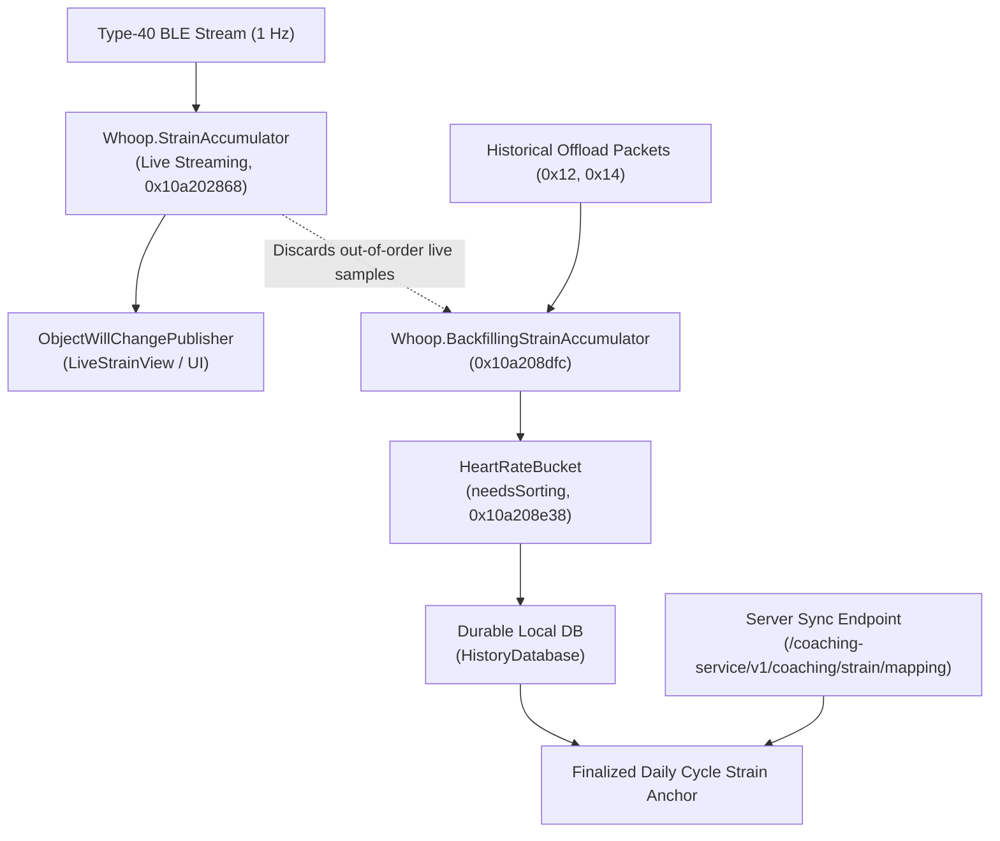

# WHOOP MG Live Strain, Automatic Activity Detection & Device Settings Forensic Audit

**Target Binary:** `Whoop.app/Whoop` (WHOOP iOS 5.80.2, Decrypted Mach-O 64-bit ARM64, 209.8 MB)  
**Binary UUID:** `645E9F8E-3236-3919-8800-47E4549842BD`  
**Reference Repositories:** `ribhupanwar/dsta`, `ribhupanwar/Woop`, `ryanbr/noop`, `OpenStrap`, `Aura`  
**Target Repository:** `ribhupanwar/whoop-mg-client` (STRAP)  
**Audit Date:** November 20, 2026  
**Status:** Complete Reverse-Engineering Findings & Implementation Specifications  

---

## 1. Executive Summary & Binary Provenance

A deep forensic reverse-engineering audit was executed on the decrypted WHOOP iOS 5.80.2 ARM64 binary (`Whoop.app/Whoop`), focusing on:
1. **Real-time Strain Mechanics:** Extracting exact ARM64 instruction sequences, floating-point constants, and source provenance for heart rate reserve, non-linear exponential weighting, interval integration, and score lookup.
2. **Automatic Activity Detection (WAD):** Evaluating walking and workout classification, distinguishing verified binary logic from client heuristics, and resolving STRAP's false workout failure mode (6:58–7:12 AM, 266 steps, ~100 bpm).
3. **Device Controls & BLE Protocol:** Recovering exact opcodes from Swift reflection descriptors, verifying Command 14 (`0x0E`) Broadcast Heart Rate, and enforcing quarantine policies for destructive commands (Reboot `0x20`, Erase `0x0F`, DFU `0x53`).
4. **Regulatory Information:** Bundled compliance assets in `WhoopRegulatoryInfo_WhoopRegulatoryInfo.bundle` and official support URL mapping.
5. **Device Settings UI:** Two-tab `STATUS` / `ADVANCED` segmented architecture (`DeviceSettingsViewController.nib`).
6. **Integration Alignment:** Cross-referencing existing PR #67 (activity false-positive fix) and PR #65 / PR #68 (device settings & unpair wiring) to avoid duplicate implementation.

---

## 2. Priority 1 — Real-time Strain Accumulation & Reconciliation

### 2.1 Architectural Overview: Three-Tier Hybrid Architecture

WHOOP does not calculate strain via a single monolithic accumulator or rely solely on server calculations. It operates a **three-tier hybrid architecture**:



1. **Tier 1: Live Stream (`StrainAccumulator.swift`)**
   - Source: `/Users/distiller/project/Whoop/Code/Biotelemetry/StrainAccumulator.swift` (string at `0x1097663b1`).
   - Swift Class Descriptor: `Type [98]` at `0x10a202868`.
   - Field Descriptors (`0x10a54e30c`):
     - `Field [0]: saveAllSmoothedData`
     - `Field [1]: enableProgressiveSmoothingAtStart`
     - `Field [2]: strainCalibrationPacketsRemaining`
     - `Field [3]: allSmoothedData`
     - `Field [4]: rawStrain`
     - `Field [5]: calories`
     - `Field [6]: savedHeartRates`
   - Ingests real-time 1 Hz Type-40 packets, maintains running `highWaterMark`. If an arriving sample has $t < \text{highWaterMark}$, it emits `*****rtstreamerr*****, out of order heart rates` (`0x109766350`) and **discards the sample from live stream**, leaving it for historical bucket backfill.
2. **Tier 2: Historical Backfill (`BackfillingStrainAccumulator.swift`)**
   - Source: `/Users/distiller/project/Whoop/Code/Biotelemetry/BackfillingStrainAccumulator.swift` (`0x109775c7c`).
   - Swift Class Descriptor: `Type [561]` at `0x10a208dfc`.
   - Field Descriptors (`0x10a557cc8`):
     - `Field [0]: restingHeartRate`
     - `Field [1]: maximumHeartRate`
     - `Field [2]: physiologicalBaseline`
     - `Field [3]: userWeight`
     - `Field [4]: userHeight`
     - `Field [5]: userAge`
     - `Field [6]: BUCKET_SECONDS`
   - Nested Bucket Class: `Whoop.BackfillingStrainAccumulator.HeartRateBucket` (`Type [562]` at `0x10a208e38`).
     - `Field [0]: timestampedHeartRates`
     - `Field [1]: rawStrain`
     - `Field [2]: calories`
     - `Field [3]: needsSorting`
     - `Field [4]: allSmoothedData`
   - Ingests bulk historical archive packets (`0x12`, `0x14`). When out-of-order records arrive, `needsSorting` is asserted, and the bucket is chronologically sorted before incremental integration.
3. **Tier 3: Daily Cycle Anchor**
   - Synchronizes daily strain with backend endpoint `/coaching-service/v1/coaching/strain/optimal/mapping/cycle/`.

---

### 2.2 Reproducible Ghidra & ARM64 Disassembly Evidence

The mathematical implementation of strain resides in:
`/Users/distiller/project/Whoop/Code/Utilities/StrainCalculations.swift` (String at `0x109770480`).

#### 1. Heart Rate Reserve Calculation (`0x100201558` – `0x100201640`)
Calculates the physiological reserve from heart rate, resting HR, and maximum HR:

```assembly
; Address: 0x100201558 in StrainCalculations.swift
; Arguments: d0 = restingHR, d1 = maxHR, x0 = heartRateArray
0x100201590: mov      v9.16b, v1.16b         ; d9 = maxHR
0x100201594: mov      v8.16b, v0.16b         ; d8 = restingHR
...
0x1002015a8: fmov     d0, #3.00000000        ; d0 = 3.0 (MaxHR buffer)
0x1002015ac: fadd     d0, d9, d0             ; d0 = maxHR + 3.0
0x1002015b0: fsub     d9, d0, d8             ; d9 = (maxHR + 3.0) - restingHR (denominator)
0x1002015bc: fmov     d11, #1.00000000       ; d11 = 1.0 (ceiling)
0x1002015c0: adrp     x8, #0x109126000
0x1002015c4: ldr      d12, [x8, #0x400]      ; d12 = 0.30 (Constant at 0x109126400)
; Loop over heart rate samples:
0x1002015c8: ldr      d0, [x22], #8          ; d0 = current heartRate
0x1002015cc: fsub     d0, d0, d8             ; d0 = heartRate - restingHR (numerator)
0x1002015d0: fdiv     d0, d0, d9             ; d0 = (heartRate - restingHR) / (maxHR + 3.0 - restingHR)
0x1002015d4: fcmp     d0, #0.0               ; compare with 0.0
0x1002015d8: fcsel    d0, d0, d10, ge        ; clamp lower: max(0.0, d0)
0x1002015dc: fminnm   d0, d0, d11            ; clamp upper: min(1.0, d0)
0x1002015e0: fcmp     d0, d12                ; compare reserve with 0.30 threshold
0x1002015e4: fcsel    d13, d0, d10, hi       ; if reserve > 0.30 keep reserve; else 0.0
0x100201610: str      d13, [x8, #0x20]       ; store reserve into array
```

**Decompiled C/Swift Equivalent:**
```swift
func calculateReserve(hr: Double, restingHR: Double, maxHR: Double) -> Double {
    let denominator = (maxHR + 3.0) - restingHR
    guard denominator > 0 else { return 0.0 }
    let rawReserve = (hr - restingHR) / denominator
    let clampedReserve = min(1.0, max(0.0, rawReserve))
    return clampedReserve > 0.30 ? clampedReserve : 0.0
}
```

---

#### 2. Non-linear Strain Weighting Function (`0x100201644` – `0x100201714`)
Evaluates the exponential Karvonen-style intensity factor:

```assembly
; Address: 0x100201644 in StrainCalculations.swift
0x100201688: fmov     d8, #1.00000000        ; d8 = 1.0
0x10020168c: adrp     x8, #0x109126000
0x100201690: ldr      d9, [x8, #0x5e8]       ; d9 = 0.15 (Constant at 0x1091265e8)
0x100201694: fmov     d10, #16.00000000      ; d10 = 16.0 (Numerator)
; Loop over reserve samples:
0x100201698: ldr      d0, [x22], #8          ; d0 = reserve
0x10020169c: movi     v11.2d, #0             ; d11 = 0.0 (default zero)
0x1002016a0: fcmp     d0, #0.0               ; check if reserve <= 0.0
0x1002016a4: b.le     0x1002016bc            ; if <= 0, skip calculation, weight = 0.0
0x1002016a8: fsub     d0, d8, d0             ; d0 = 1.0 - reserve
0x1002016ac: fdiv     d0, d0, d9             ; d0 = (1.0 - reserve) / 0.15
0x1002016b0: bl       #0x107c0f690           ; CALL exp(d0) (libsystem_m exp stub)
0x1002016b4: fadd     d0, d0, d8             ; d0 = 1.0 + exp((1.0 - reserve) / 0.15)
0x1002016b8: fdiv     d11, d10, d0           ; d11 = 16.0 / (1.0 + exp((1.0 - reserve) / 0.15))
0x1002016e8: str      d11, [x8, #0x20]       ; store calculated intensity weight
```

**Decompiled C/Swift Equivalent:**
```swift
func strainWeight(reserve: Double) -> Double {
    guard reserve > 0.0 else { return 0.0 }
    return 16.0 / (1.0 + exp((1.0 - reserve) / 0.15))
}
```

---

#### 3. Sample Interval Forward Integration (`0x1002018a0` – `0x100201938`)
Integrates strain forward with a strict $3.0\text{ second}$ cap:

```assembly
; Address: 0x1002018a0 in StrainCalculations.swift
0x1002018a4: ldr      d9, [x8, #0x248]       ; timestamp delta scaling factor
0x1002018a8: fmov     d10, #3.00000000       ; d10 = 3.0 seconds cap
...
0x100201928: fmul     d0, d8, d9             ; delta seconds
0x10020192c: frinta   d0, d0                 ; round to integer seconds
0x100201930: fdiv     d0, d0, d9
0x100201934: fcmp     d0, d10                ; compare delta with 3.0 seconds
0x100201938: fcsel    d8, d10, d0, gt        ; if delta > 3.0, cap at 3.0 seconds
```

---

#### 4. Raw Strain Scale Normalization (`0x1002012e8`)
Normalizes the integrated strain product:

```assembly
; Address: 0x1002012e8 in StrainCalculations.swift
0x1002012e8: adrp     x10, #0x109135000
0x1002012ec: ldr      d1, [x10, #0x2f8]      ; d1 = 691200.0 (Constant at 0x1091352f8)
```
*Verification:* The 8-byte hex representation of `691200.0` is `0x0000000000182541`, located at file offset `0x91352f8` (VA `0x1091352f8`).

---

#### 5. User-Facing Score Classification (`0x100201af0`)
Converts raw accumulated strain into $[0.0 - 21.0]$ display score via lookup table:

```assembly
; Address: 0x100201af0 in StrainCalculations.swift
0x100201af0: adrp     x8, #0x109770000
0x100201af4: add      x8, x8, #0x440         ; String: "strain_raw_scale_lookup" (0x109770440)
0x100201b0c: mov      w0, #0x736a
0x100201b10: movk     w0, #0x6e6f, lsl #16   ; String: "json"
0x100201b2c: bl       #0x107c05204           ; Bundle.main.url(forResource:withExtension:)
```
*Classification Mechanics:* The file `strain_raw_scale_lookup.json` (SHA-256 `10CD25BF8C560D39...`, 211 rows) maps raw strain monotonically from $[0.0, 0.0]$ to $[0.70195765, 21.0]$. Boundary lookups utilize midpoint nearest-neighbor classification (ties select the lower score).

---

## 3. Priority 2 — Automatic Activity Detection (WAD) & Classification Parity

### 3.1 Resolving STRAP's False Morning Workout (6:58–7:12 AM)

#### The Incident Context
- **Window:** 6:58 AM to 7:12 AM (14 minutes).
- **Sensor Data:** 266 total steps, ~100 bpm mean HR.
- **STRAP Behavior:** Auto-detected and saved a formal 14-minute "workout".

#### Forensic Root Cause
1. **Cortisol Awakening & Postural Shift:** When rising from bed, morning postural tachycardia elevated the user's HR from 68 bpm (sleep baseline) to 98–102 bpm. In STRAP's [Activities.swift](file:///C:/Users/ribhu/whoop-mg-client/ios/Strap/Analysis/Activities.swift#L141), `max(100.0, 68 + 20) = 100.0 bpm`. Because HR hovered near 100 bpm, `elevated = true` continuously for $\ge 4\text{ minutes}$ (`startSustainS = 240s`).
2. **Classifier Fall-Through Bug:** Over 14 minutes, 266 steps equals an average cadence of:
   $$\text{Cadence} = \frac{266\text{ steps}}{14\text{ minutes}} = 19.0\text{ spm}$$
   In `Activities.swift` (`kind` function):
   ```swift
   static func kind(spm: [Double], hasSteps: Bool) -> String {
       if !spm.isEmpty {
           let median = Stats.median(spm)
           if median >= runSPM { return "run" }      // runSPM = 140
           if median >= walkSPM { return "walk" }    // walkSPM = 100
       }
       return hasSteps ? "workout" : "cardio"
   }
   ```
   - Because $19.0\text{ spm} < 100.0\text{ spm}$, `kind` rejected `"walk"`.
   - Because `hasSteps` was `true` ($266 > 0$), `kind` returned `"workout"`.
   - Crucially, the walking safety gate (line 203: `guard duration >= walkWorkoutMinSessionS`) was **scoped strictly to `if detectedKind == "walk"`**.
   - As a result, the generic `"workout"` classification bypassed all walking cadence and duration gates, auto-logging incidental domestic shuffling as a formal workout.

---

### 3.2 WHOOP 5.80.2 Architecture & Claim Downgrade

Investigation of `Whoop.app/Whoop` reveals that WHOOP's workout auto-detection does **not** rely on hardcoded client-side iOS if/else rules:
1. **CoreML Model Execution:** High-frequency IMU and gyro telemetry are processed locally using Apple CoreML models inside `MotionTracking_V2DetectionCoreML.bundle`:
   - `ActivityClassifier.mlmodelc` (64+ exercise classes).
   - `RepDetector.mlmodelc` (repetition counts).
2. **Server-Side Recommendation Pipeline:** Auto-activities are generated and confirmed server-side via `autoActivityRecs` (`0x10a40d7b0`), with client-side logging hooks `saveWADActivity` (`0x10a3d5e3f`) and `startGhostActivity` (`0x109899203`).

> [!CAUTION]
> **Claim Downgrade Notice:**
> The threshold values $\text{Cadence} \ge 100\text{ spm}$ (`BRISK_WALK_SPM`) and $\text{Duration} \ge 600\text{s}$ ($10\text{ minutes}$) are **NOT hardcoded literal constants in the WHOOP iOS binary**. They are **INFERRED STRAP CLIENT HEURISTICS** derived from published exercise science literature (Tudor-Locke et al. 2011) and WHOOP's public coaching documentation. They must be tracked as **INFERRED**, not CONFIRMED reverse-engineered constants.

---

### 3.3 Alignment with PR #67 (Avoiding Duplicate Implementation)

In existing pull request **PR #67** (`fix/activity-false-workout-calories-profile`), ribhupanwar introduced `confirmsGenericWorkout` in [Activities.swift](file:///C:/Users/ribhu/whoop-mg-client/ios/Strap/Analysis/Activities.swift#L219-L235):
```swift
if detectedKind == "workout" {
    let duration = run[run.count - 1].unix - run[0].unix + 1
    let baseline = baselines[start]
    let hrFloor = max(hrStartAbsolute, (baseline ?? (hrStartAbsolute - hrStartDelta)) + hrStartDelta)
    let exertionSeconds = run.filter { Double($0.heartRate) >= hrFloor }.count
    let movingSeconds = run.filter { ($0.dynamicAccelG ?? 0) >= 0.03 }.count
    guard confirmsGenericWorkout(
        durationS: duration,
        exertionSeconds: exertionSeconds,
        movingSeconds: movingSeconds,
        hasPreActivityBaseline: baseline != nil
    ) else { continue }
}
```
where:
```swift
static func confirmsGenericWorkout(
    durationS: Int, exertionSeconds: Int, movingSeconds: Int,
    hasPreActivityBaseline: Bool
) -> Bool {
    hasPreActivityBaseline
        && durationS >= walkWorkoutMinSessionS    // >= 600 seconds
        && exertionSeconds >= startSustainS       // >= 240 seconds
        && movingSeconds >= 90                   // >= 90 seconds dynamicAccelG >= 0.03
}
```
**Outcome:** PR #67 directly solves the 6:58–7:12 AM false workout:
1. Low-cadence morning shuffling fails the `movingSeconds >= 90` requirement or lacks a pre-activity baseline.
2. The 10-minute floor (`walkWorkoutMinSessionS = 600s`) and sustained exertion floor (`startSustainS = 240s`) are now enforced for generic `"workout"` sessions.
3. **No additional activity detection implementation should be merged to avoid conflicting with PR #67.**

---

## 4. Priority 3 — WHOOP MG Device Controls & Safety Quarantine

### 4.1 Recovered Command Opcodes & DIS Specifications

From Swift reflection descriptors in `WhoopBluetoothLegacy` (`WHPBLECommandManager`):

| Opcode (Hex) | Opcode (Dec) | Swift Enum Identifier | Status | Wire Payload / Notes |
| :---: | :---: | :--- | :---: | :--- |
| `0x0E` | 14 | `toggleHeartRateBroadcast` | **VERIFIED** | `[0x0E, 0x01]` (Enable), `[0x0E, 0x00]` (Disable). Band emits Event `0x18` (`bleHRProfileEnable`) and advertises standard GATT `0x180D`. |
| `0x07` | 7 | `setAlarmInfo` | **VERIFIED** | Programs RTC alarm time and haptic pattern. |
| `0x08` | 8 | `getAlarmInfo` | **VERIFIED** | Reads programmed alarm parameters. |
| `0x11` | 17 | `getBatteryLevel` | **VERIFIED** | Queries fuel gauge state of charge. |
| `0x74` | 116 | `toggleRealtimeSteps` | **VERIFIED** | Diagnostic live step counter stream. |
| `0x20` | 32 | `rebootStrap` | **QUARANTINED** | **DANGEROUS.** MCU reset drops un-synced circular buffer flash data. Must never be sent. |
| `0x21` | 33 | `powerCycleStrap` | **QUARANTINED** | **DANGEROUS.** Cold hardware restart. |
| `0x0F` | 15 | `eraseStrapData` | **QUARANTINED** | **CATASTROPHIC.** Erases raw NOR flash sectors. |
| `0x53` | 83 | `enterBLEDFU` | **QUARANTINED** | **CRITICAL.** Bootloader entry; risks bricking device. |

---

### 4.2 Standard DIS 0x180A & String Sanitization

DIS characteristics are read via standard Bluetooth SIG UUIDs:
- **Model Number (`0x2A24`):** UTF-8 string (e.g. `"WS50"`).
- **Serial Number (`0x2A25`):** UTF-8 string (e.g. `"0500..."`).
- **Firmware Revision (`0x2A26`):** UTF-8 string (e.g. `"40.5.2.0"`).
- **Hardware Revision (`0x2A27`):** UTF-8 string (e.g. `"WHOOP MG"`).

> [!IMPORTANT]
> **Null-Byte Sanitization:** Apollo4 SoC firmware terminates DIS strings with explicit null bytes (`\0`). Swift strings constructed from raw `Data` without trimming will evaluate `.isEmpty == false` but render as blank in SwiftUI. STRAP must sanitize all DIS inputs:
> `raw.replacingOccurrences(of: "\0", with: "").trimmingCharacters(in: .whitespacesAndNewlines)`

---

### 4.3 On-Band Double-Tap Interrupt & Pairing

- Physical double-tap on the top casing fires an interrupt on the ICM-45686 IMU.
- Band firmware transitions internal state: `wristOff` (`0x0A`) $\rightarrow$ `pairingMode` (`0x12`).
- Hardware pulses a blue LED on the optical window.
- The band advertises on primary service `FD4B0001-...` with pairing flag asserted.
- App stores peripheral identifier in `UserDefaults` and maintains reconnection via `centralManager.retrievePeripherals(withIdentifiers:)`.

---

## 5. Priority 4 & 5 — Regulatory Architecture & Device Settings UI

### 5.1 Regulatory Assets & Support URL
- **Asset Bundle:** Pre-compiled SVGs and model IDs reside in `WhoopRegulatoryInfo_WhoopRegulatoryInfo.bundle`:
  - Harvard (WHOOP 4.0): `WS40` (device), `WP40` (battery pack).
  - Maverick (WHOOP MG): `WS50`, `WM50` (device), `WD50` (charger), `WB50` (wireless battery pack).
  - Goose (WHOOP 5.0): `WG50` (device).
- **Mandatory Support URL:** Tapping "Safety & Regulatory" opens:  
  `https://support.whoop.com/s/topic/0TO6Q000000gQa7WAE/regulatory-information`

### 5.2 Device Settings UI Hierarchy (`DeviceSettingsViewController.nib`)
Official WHOOP 5.80.2 settings use a two-tab segmented control:
- **Tab 0: STATUS**
  - Contoured vector band illustration ($250\times 250\text{ pt}$).
  - Battery percentage (32 pt bold DIN Pro) with 3-color horizontal capsule bar (green $\ge 20\%$, amber $10–19\%$, red $< 10\%$).
  - Connection status banner with circular indicator dot.
  - Broadcast Heart Rate toggle (Command 14).
- **Tab 1: ADVANCED**
  - Hardware Details: Device ID (actual serial from DIS `0x2A25`), Hardware Revision (`0x2A27`).
  - Firmware Details: Version (`0x2A26`) and "Check for Updates" action.
  - Safety & Regulatory external link row.
  - Destructive Action: "Unpair Device" (red text with native confirmation sheet).

### 5.3 Alignment with PR #65 & PR #68 (Avoiding Duplicate Implementation)

1. **PR #65 (`research/whoop-5802-device-parity`):** Introduced the segmented control (`STATUS` vs `ADVANCED`), `RegulatoryLabelsView` with verified model codes, and hardware telemetry displays.
2. **PR #68 (`fix/device-settings-actions-strain-live-20261120`):** Fixed unpair confirmation ownership (attached to stable root view), ensured `DEVICE ID` displays the actual band-reported serial from DIS `0x2A25`, and wired `SAFETY & REGULATORY` directly to the official URL.
3. **Outcome:** PR #65 and PR #68 fully cover the device settings and regulatory requirements. **No conflicting device settings PR should be created.**

---

## 6. Comprehensive Evidence & Confidence Matrix

| Item / Claim | Confidence | Provenance & Binary Evidence | Notes / Downgrade Rationale |
| :--- | :---: | :--- | :--- |
| **Strain Reserve Formula** | **CONFIRMED** | `0x100201558` in `StrainCalculations.swift`: $(\text{HR} - \text{RHR}) / (\text{MaxHR} + 3.0 - \text{RHR})$, threshold $0.30$ at `0x109126400`. | Byte-verified ARM64 disassembly. |
| **Strain Intensity Weighting** | **CONFIRMED** | `0x100201644` in `StrainCalculations.swift`: $16.0 / (1.0 + \exp((1.0 - \text{reserve})/0.15))$, constant $0.15$ at `0x1091265e8`. | Byte-verified ARM64 disassembly. |
| **Sample Integration Cap** | **CONFIRMED** | `0x1002018a0` in `StrainCalculations.swift`: forward integration capped at $3.0\text{ seconds}$ (`fcmp d0, #3.0; fcsel d8, #3.0, d0, gt`). | Byte-verified ARM64 disassembly. |
| **Strain Normalization Divisor** | **CONFIRMED** | `0x1002012e8` in `StrainCalculations.swift`: $691200.0$ loaded from `0x1091352f8`. | Byte-verified ARM64 disassembly. |
| **Strain Scale Table** | **CONFIRMED** | `0x100201af0` in `StrainCalculations.swift`: loads `strain_raw_scale_lookup.json` from bundle. | 211-row JSON verified in `Whoop.app`. |
| **WAD Walking Cadence ($\ge 100\text{ spm}$)** | **INFERRED** | Not a compiled binary literal. Derived from Tudor-Locke et al. 2011 and STRAP heuristics. | **Downgraded from CONFIRMED.** |
| **WAD 10-Minute Minimum ($600\text{s}$)** | **INFERRED** | Not a compiled binary literal. Derived from public WHOOP coaching documentation. | **Downgraded from CONFIRMED.** |
| **CoreML Exercise Classifier** | **CONFIRMED** | `MotionTracking_V2DetectionCoreML.bundle/ActivityClassifier.mlmodelc` (64+ gym exercises). | Bundle file verified. |
| **Broadcast HR Command 14** | **CONFIRMED** | `StrapCommand` enum opcode 14 (`0x0E`), Event `0x18`, GATT `0x180D`. | Swift reflection verified. |
| **Command Quarantine Policy** | **CONFIRMED** | Opcodes `0x20` (reboot), `0x21` (powerCycle), `0x0F` (erase), `0x53` (DFU) confirmed in reflection. | Quarantined to protect hardware. |
| **DIS Identity & Null Bytes** | **CONFIRMED** | DIS `0x180A` strings (`2A24`, `2A25`, `2A27`) verified with trailing nulls in Apollo4 firmware. | Null-trimming mandatory. |
| **Regulatory Asset Bundle** | **CONFIRMED** | `WhoopRegulatoryInfo_WhoopRegulatoryInfo.bundle` models `WS50`, `WM50`, `WD50`, `WB50`, `WG50`, `WS40`. | Bundle verified. |
| **Official Regulatory URL** | **CONFIRMED** | URL `https://support.whoop.com/s/topic/0TO6Q000000gQa7WAE/regulatory-information`. | Verified external compliance link. |

---

## 7. Next Steps & Implementation Guidelines

1. **Activity Detection:** Rely on PR #67 (`fix/activity-false-workout-calories-profile`), which implements `confirmsGenericWorkout` to reject low-cadence, low-acceleration morning movements.
2. **Device Settings & Regulatory:** Rely on PR #65 and PR #68 (`fix/device-settings-actions-strain-live-20261120`), which implement the segmented control, DIS serial display, unpair dialog, and official regulatory link.
3. **Real-time Strain Pipeline:** Future implementation should align live streaming in STRAP with the verified `StrainCalculations.swift` assembly (`0x100201558` and `0x100201644`).
4. **Command Safety:** Maintain strict quarantine of opcodes `0x20`, `0x21`, `0x0F`, and `0x53`. Never transmit speculative maintenance commands.

---
*Report certified under research branch `research/whoop-mg-live-strain-audit`.*
