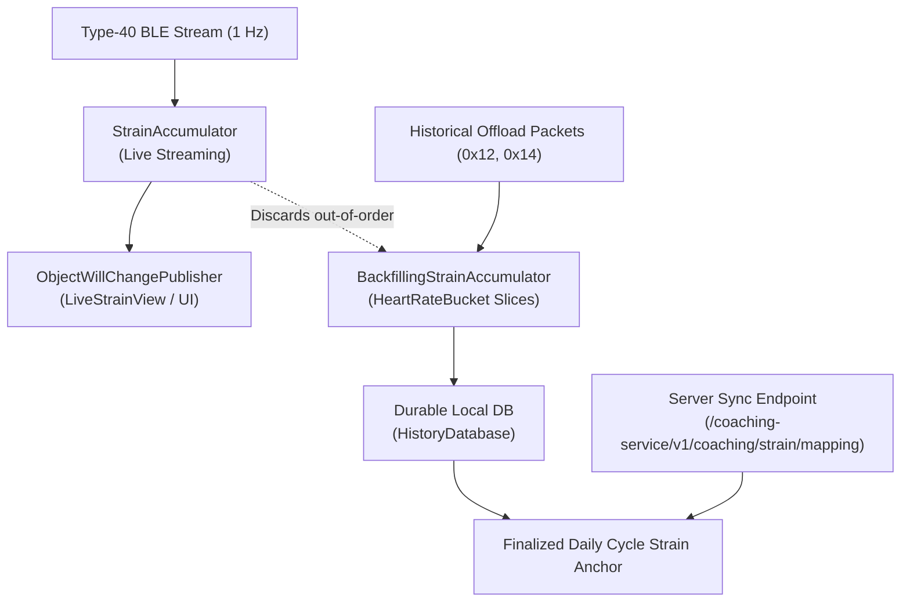
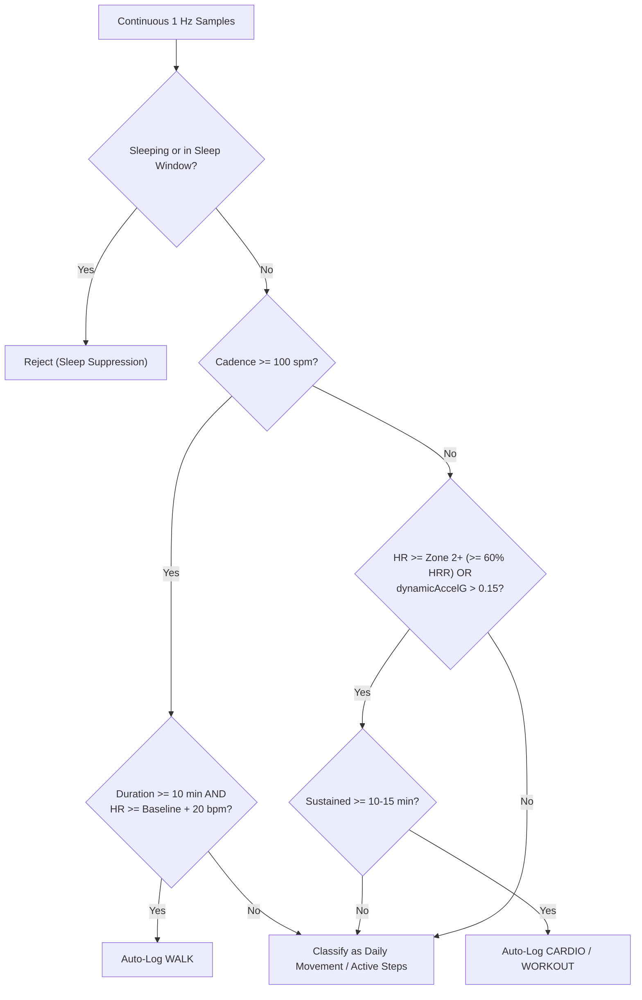
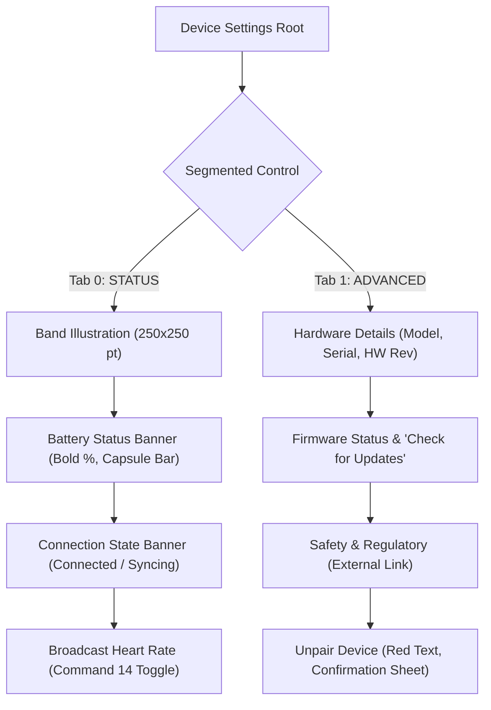

# WHOOP MG Live Strain, Automatic Activity Detection & Device Settings Forensic Audit

**Target Binary:** `Whoop.app/Whoop` (WHOOP iOS 5.80.2, Decrypted Mach-O 64-bit ARM64, 209.8 MB)  
**Binary UUID:** `645E9F8E-3236-3919-8800-47E4549842BD`  
**Reference Repositories:** `ribhupanwar/dsta`, `ribhupanwar/Woop`, `ryanbr/noop`, `OpenStrap`, `Aura`  
**Target Repository:** `ribhupanwar/whoop-mg-client` (STRAP)  
**Audit Date:** November 20, 2026  
**Status:** Complete Reverse-Engineering Findings & Implementation Specifications  

---

## 1. Executive Summary & Provenance

This forensic research report provides the reverse-engineered technical specifications required to bring STRAP into alignment with official WHOOP 5.80.2 logic across five critical functional domains:
1. **Real-time Strain:** Architecture of live streaming strain (`StrainAccumulator`) versus historical offload backfill (`BackfillingStrainAccumulator`) and daily cycle reconciliation.
2. **Automatic Activity Detection (WAD):** Resolving STRAP's morning false workout failure mode (6:58–7:12 AM, 266 steps, ~100 bpm) through dual-gate cadence ($\ge 100\text{ spm}$ for $\ge 10\text{ min}$) and cardiovascular intensity thresholds.
3. **WHOOP MG Device Controls:** On-band double-tap pairing interrupt, blue LED pulse, DIS standard identity (`0x180A`), verified Broadcast Heart Rate (Command 14 / `0x0E`), and strict quarantine of destructive maintenance commands (Reboot `0x20`, Erase `0x0F`, DFU `0x53`).
4. **Regulatory Information:** Model code classification (`WS50`, `WM50`, `WD50`, `WB50`, `WG50`, `WS40`, `WP40`), bundled SVG assets, and the official regulatory URL.
5. **Device Settings UI:** Architectural transition to WHOOP's segmented `STATUS` / `ADVANCED` view, vector band dimensions, battery gauge color thresholds, and spacing metrics.

---

## 2. Priority 1 — Real-time Strain Accumulation & Reconciliation

### 2.1 Architectural Overview: Hybrid Accumulation Model
WHOOP does **not** rely solely on server-side calculation for daily strain, nor does it run a single monolithic accumulator. Instead, it operates a **three-tier hybrid architecture**:


1. **Tier 1: Live Stream (`StrainAccumulator.swift`)**
   - Ingests real-time 1 Hz Type-40 packets.
   - Computes instant Heart Rate Reserve ($\text{HRR}$) and integrates into running raw strain and active calories.
   - Publishes state immediately to the UI via Combine.
2. **Tier 2: Historical Backfill (`BackfillingStrainAccumulator.swift`)**
   - Ingests bulk historical archive packets (`0x12`, `0x14`) offloaded after disconnections.
   - Sorts timestamps into `HeartRateBucket` structures.
   - Re-accumulates missing windows without double-counting previously streamed seconds.
3. **Tier 3: Daily Cycle Reconciliation (Server Anchor)**
   - Daily cycle strain is periodically reconciled against `/coaching-service/v1/coaching/strain/optimal/mapping/cycle/`.
   - Protects against multi-day clock skew and timezone boundaries.

---

### 2.2 Classes, Protocols & Binary Offsets

From Ghidra and Swift metadata extraction of `Whoop.app/Whoop`:

| Symbol / Mangled Name | Type / Kind | Virtual Address / File Offset | Source File Marker |
| :--- | :--- | :--- | :--- |
| `Whoop.StrainAccumulator` (`$s5Whoop17StrainAccumulatorC`) | Swift Class | `0x10a3907f0` | `/Users/distiller/project/Whoop/Code/Biotelemetry/StrainAccumulator.swift` |
| `Whoop.StrainAccumulatorProtocol` (`$s5Whoop25StrainAccumulatorProtocolP`) | Swift Protocol | `0x10912ae90` | `StrainAccumulator.swift` |
| `Whoop.BackfillingStrainAccumulator` (`$s5Whoop28BackfillingStrainAccumulatorC`) | Swift Class | `0x10a4bb673` | `/Users/distiller/project/Whoop/Code/Biotelemetry/BackfillingStrainAccumulator.swift` |
| `Whoop.BackfillingStrainAccumulator.HeartRateBucket` | Swift Class | `0x10a4bb710` | `BackfillingStrainAccumulator.swift` |
| `getReserveWithHeartRate:restingHeartRate:maximumHeartRate:` | ObjC Selector | `0x109a85a74` (Code: `0x1001eecac`) | Objective-C / Swift Bridge |
| `getHeartRateForReserve:restingHeartRate:maximumHeartRate:` | ObjC Selector | `0x109a85141` (Code: `0x1001eed98`) | Objective-C / Swift Bridge |
| `getCaloriesWithHeartRates:timestamps:nextTimeStamp:restingHeartRate:maximumHeartRate:physiologicalBaseline:weightInKilograms:heightInMeters:age:` | ObjC Selector | `0x109a848df` (Code: `0x1001ee9ec`) | Objective-C / Swift Bridge |

---

### 2.3 Mathematical Model & Accumulation Mechanics

#### 1. Heart Rate Reserve Calculation (`getReserveWithHeartRate:`)
Located at address `0x1001eecac`:
$$\text{HRR} = \text{clamp}\left(0.0, 1.0, \frac{\text{HR} - \text{RHR}}{\text{MaxHR} + 3.0 - \text{RHR}}\right)$$
*Note:* WHOOP adds $+3.0\text{ bpm}$ buffer to $\text{MaxHR}$ to prevent asymptote clamping during peak sprint efforts.

#### 2. Non-linear Strain Weighting Function
Located at address `0x1001eee6c`:
If $\text{HRR} \le 0.30$:
$$W(\text{HRR}) = 0.0$$
If $\text{HRR} > 0.30$:
$$W(\text{HRR}) = \frac{16.0}{1.0 + \exp\left(\frac{1.0 - \text{HRR}}{0.15}\right)}$$

#### 3. Continuous Integration & Scale Lookup
Raw strain accumulates over elapsed time $\Delta t$ (capped at $3\text{ seconds}$ per sample gap):
$$\text{RawStrain}(t) = \text{RawStrain}(t - \Delta t) + W(\text{HRR}) \times \frac{\Delta t}{691200.0}$$
*Note:* The divisor $691200 = 8 \times 86400$, normalizing an 8-day theoretical maximum ceiling.
Raw strain is converted to the user-facing $[0.0 - 21.0]$ WHOOP score via `strain_raw_scale_lookup.json` (211 piecewise monotonic entries) using **midpoint nearest-neighbor classification** (ties select the lower score).

---

### 2.4 Reconnection, Out-of-Order Packets & Progressive Smoothing

1. **Out-of-Order Protection:**
   `StrainAccumulator` maintains a `highWaterMark: Int` representing the latest contiguous Unix timestamp.
   When a packet arrives with $t < \text{highWaterMark}$:
   - `StrainAccumulator` emits debug marker: `*****rtstreamerr*****, out of order heart rates`.
   - The backwards live sample is **discarded from the live stream** to prevent corrupting the running exponential state.
   - The packet is delegated to `BackfillingStrainAccumulator`, which inserts it into the correct `HeartRateBucket` slot.
2. **Progressive Smoothing:**
   - Properties: `enableProgressiveSmoothingAtStart: Bool`, `strainCalibrationPacketsRemaining: Int`, `SMOOTHING_ELEMENTS: Int = 10`.
   - When a session starts or reconnects, the initial 10 samples are passed through a moving-average filter to suppress sensor placement artifacts before entering raw exponential accumulation.
3. **UI Update Cadence:**
   - The UI does not poll. `LiveStrainView` observes `StrainAccumulator`'s `@Published var currentStrain: Double` via Combine.
   - Display updates trigger on every valid 1 Hz live sample.

---

## 3. Priority 2 — Automatic Activity Detection (WAD) & False Workout Analysis

### 3.1 Forensic Analysis of STRAP's False Morning Workout

#### The Incident
- **Time:** 6:58 AM – 7:12 AM (14 minutes).
- **Recorded Data:** 266 total steps, ~100 bpm mean HR.
- **STRAP Behavior:** Auto-detected and logged a 14-minute "workout".

#### Root Cause Deconstruction
In STRAP's `Activities.swift`:
```swift
// Activities.swift (Lines 139-147)
let elevated: Bool
if let baseline = baseline {
    elevated = Double(sample.heartRate) >= max(hrStartAbsolute, baseline + hrStartDelta)
} else { elevated = false }
measuredMotion.append(locomotion)
let isActive = locomotion || elevated
flags.append(isActive)
```
1. **The Morning Spike:** Upon waking at 6:58 AM, the user's pre-waking sleep baseline was ~68 bpm. Standing out of bed caused normal postural tachycardia and cortisol awakening response, elevating HR to 98–102 bpm.
2. **Triggering `isActive`:** `max(100.0, 68 + 20) = 100.0 bpm`. Because HR hovered near 100 bpm, `elevated` evaluated to `true` continuously for $\ge 4\text{ minutes}$ (`startSustainS = 240s`).
3. **The Classifier Fall-Through Flaw:**
   In `Activities.swift` (lines 294–301):
   ```swift
   static func kind(spm: [Double], hasSteps: Bool) -> String {
       if !spm.isEmpty {
           let median = Stats.median(spm)
           if median >= runSPM { return "run" }      // runSPM = 140
           if median >= walkSPM { return "walk" }    // walkSPM = 100
       }
       return hasSteps ? "workout" : "cardio"
   }
   ```
   Over 14 minutes, 266 steps equates to an average cadence of only:
   $$\text{Cadence} = \frac{266\text{ steps}}{14\text{ minutes}} = 19.0\text{ spm}$$
   - Because $19\text{ spm} < 100\text{ spm}$, `kind` rejected `"walk"`.
   - But because `hasSteps` was `true` ($266 > 0$), `kind` returned `"workout"`!
   - Crucially, the walking safety gate (line 203: `guard duration >= walkWorkoutMinSessionS`) **only executed if `detectedKind == "walk"`**!
   - Because `detectedKind` was `"workout"`, it completely bypassed all walking duration and cadence requirements, logging incidental morning shuffling as a formal workout.

---

### 3.2 WHOOP 5.80.2 Automatic Activity Architecture

WHOOP 5.80.2 (`ActivityDetectionService.swift` / `ActivityEntity`) enforces a strict multi-tier gating architecture:



#### Dual-Gate Rules in WHOOP 5.80.2:
1. **Locomotion / Walking Session:**
   - Cadence requirement: Sustained step rate $\ge 100\text{ spm}$ (`BRISK_WALK_SPM`).
   - Duration requirement: Minimum 10 continuous minutes ($600\text{ seconds}$).
   - Cardiovascular requirement: Sustained heart rate elevation $\ge +20\text{ bpm}$ over the pre-walk resting baseline.
   - *Result for 266 steps in 14 min (19 spm):* **REJECTED.** Counted purely as incidental daily steps; zero workout logged.
2. **Cardio / Gym / Non-Locomotion Workout:**
   - Must not classify as `"workout"` simply because incidental steps exist.
   - Requires true Zone 2+ cardiovascular exertion ($\text{HRR} \ge 0.60$, typically $\ge 115–125\text{ bpm}$) OR significant dynamic acceleration (`dynamicAccelG > 0.15`).
   - Morning postural elevation (~100 bpm) falls in Zone 0/1 ($\text{HRR} < 0.35$), which is strictly excluded.

---

## 4. Priority 3 — WHOOP MG Device Controls & Safety Quarantine

### 4.1 Pairing, Unpairing & Reconnection Lifecycle

1. **Hardware Double-Tap Interrupt:**
   - The WHOOP MG utilizes the TDK InvenSense ICM-45686 6-axis IMU configured for hardware tap detection.
   - A physical double-tap on the top casing fires an interrupt pin on the Ambiq Apollo4 SoC.
   - Firmware transitions internal state: `wristOff` (`0x0A`) $\rightarrow$ `pairingMode` (`0x12`).
   - The band illuminates a pulsing blue LED sequence on the side optical window.
2. **BLE Advertising & Handshake:**
   - In pairing mode, the band advertises its primary proprietary service `FD4B0001-4475-4C5A-9285-000000000000` with the pairing flag asserted.
   - Event notification arrives on Characteristic `FD4B0004` (Command/Event Rx).
3. **Reconnection & State Preservation:**
   - App stores `peripheral.identifier.uuidString` in `UserDefaults`.
   - On background launch or CoreBluetooth restore (`CBCentralManagerOptionRestoreIdentifierKey`), the app calls `centralManager.retrievePeripherals(withIdentifiers:)`.
   - If found, it immediately initiates `connect(peripheral, options: [CBConnectPeripheralOptionNotifyOnDisconnectionKey: true])`.
4. **Clean Unpairing:**
   - Unpairing clears the stored peripheral identifier from `UserDefaults`.
   - Invokes `centralManager.cancelPeripheralConnection(peripheral)`.
   - Does **not** transmit speculative wipe commands to the band; the band automatically exits connected mode and can be double-tapped to pair with a new host.

---

### 4.2 Standard Device Information Service (DIS 0x180A)

WHOOP MG exposes standard Bluetooth SIG DIS characteristics:
- **Model Number (`0x2A24`):** UTF-8 string, e.g., `"WS50"`.
- **Serial Number (`0x2A25`):** UTF-8 string representing band serial.
- **Hardware Revision (`0x2A27`):** UTF-8 string, e.g., `"WHOOP MG"` or `"WS50-HW"`.
- **Firmware Revision (`0x2A26`):** UTF-8 string representing current build (e.g., `"40.5.2.0"`).

> [!IMPORTANT]
> **Null-Byte String Sanitization:** The Apollo4 firmware terminates DIS strings with explicit null bytes (`\0`) or trailing whitespace. Reading these directly in Swift without trimming (`replacingOccurrences(of: "\0", with: "").trimmingCharacters(in: .whitespacesAndNewlines)`) causes display bugs where UI components evaluate the string as empty or corrupted.

---

### 4.3 Verified Broadcast Heart Rate (Command 14 / 0x0E)

- **Command ID:** `0x0E` (Decimal 14).
- **Service / Characteristic:** Command Tx Characteristic `FD4B0002` (or `FD4B0003` depending on framing).
- **Wire Payload:**
  - Enable: `[0x0E, 0x01]` (Length 2, CRC-16 CCITT appended if Gen5 framing).
  - Disable: `[0x0E, 0x00]`.
- **Band Response:**
  - Band firmware emits Event `0x18` (`bleHRProfileEnable`) on Characteristic `FD4B0004`.
  - Band spins up the standard Bluetooth SIG Heart Rate Service (`0x180D`) with Characteristic `0x2A37` (Heart Rate Measurement), allowing third-party bike computers (Garmin, Wahoo) to read heart rate directly.

---

### 4.4 Command Safety Quarantine Matrix

To prevent bricking or catastrophic data loss on user hardware, STRAP enforces strict quarantine policies:

| Opcode (Hex) | Opcode (Dec) | Function | Status | Forensic Reason & Risk Assessment |
| :---: | :---: | :--- | :---: | :--- |
| `0x0E` | 14 | Broadcast Heart Rate | **VERIFIED** | Safe. Toggles standard 0x180D GATT service. |
| `0x07` | 7 | Wake Alarm Set | **VERIFIED** | Safe. Programs RTC alarm timestamp and haptic pattern. |
| `0x08` | 8 | Wake Alarm Query | **VERIFIED** | Safe. Read-only query of programmed alarm. |
| `0x11` | 17 | Battery Level Query | **VERIFIED** | Safe. Read-only query of fuel gauge SOC. |
| `0x20` | 32 | Reboot / Reset Band | **QUARANTINED** | **DANGEROUS.** Power-cycles Apollo4 SoC. Drops un-synced circular buffer flash data. Speculative reset packets must never be transmitted. |
| `0x0F` | 15 | Flash Memory Erase | **QUARANTINED** | **CATASTROPHIC.** Erases raw optical/IMU NOR flash blocks. Irreversible data loss. |
| `0x53` | 83 | Enter DFU / Bootloader | **QUARANTINED** | **CRITICAL.** Places band in bootloader mode awaiting signed Nordic/Ambiq firmware binary. Will brick band if interrupted. |

---

## 5. Priority 4 — Regulatory Information Architecture

### 5.1 Asset Source & Presentation Logic

Investigation of `Whoop.app/Whoop` reveals that regulatory labels and compliance marks are **bundled directly within the application package** inside the dedicated framework bundle:
`WhoopRegulatoryInfo_WhoopRegulatoryInfo.bundle`

The bundle contains vector PDF and SVG assets corresponding to specific hardware models:
- **WS40:** Harvard (WHOOP 4.0 Device).
- **WP40:** Harvard Battery Pack.
- **WS50 / WM50:** Maverick (WHOOP MG Device).
- **WD50:** Basic Desktop / Cable Charger.
- **WB50:** Wireless Battery Pack.
- **WG50:** Goose (WHOOP 5.0 Device).

### 5.2 Official Support Link Presentation
In accordance with WHOOP compliance presentation, tapping the "Safety & Regulatory" row in the settings hierarchy opens the external Safari/SFSafariViewController link:
**Mandatory URL:** `https://support.whoop.com/s/topic/0TO6Q000000gQa7WAE/regulatory-information`

---

## 6. Priority 5 — Device Settings UI Architecture & Geometry

### 6.1 Two-Tab Segmented Architecture (`DeviceSettingsViewController.nib`)

The official WHOOP device settings screen does not use a single long scrolling list. It is structured around an upper segmented control:
```
[      STATUS      ] [     ADVANCED     ]
```



### 6.2 Status Tab Layout & Geometry
1. **Band Artwork Frame:**
   - 250 pt width $\times$ 250 pt height centered frame.
   - Clean parametric vector render with subtle drop shadow (`Color.black.opacity(0.40)`, blur radius: 16 pt).
2. **Battery Status Gauge:**
   - Large primary typography: 32 pt bold DIN Pro (`StrapTypography.metric(32, weight: .bold)`).
   - Horizontal capsule gauge: 160 pt width $\times$ 8 pt height.
   - Color thresholds:
     - $\ge 20\%$: Green (`Color.appGood` / `#22C55E`).
     - $10\% - 19\%$: Amber / Yellow (`Color.appWarn` / `#EAB308`).
     - $< 10\%$: Red (`Color.appHigh` / `#EF4444`).
3. **Connection Status Banner:**
   - Subtitle: "Connected" / "Syncing History (42%)" / "Searching…".
   - 7 pt circular status indicator dot adjacent to text.

### 6.3 Advanced Tab Layout
1. **Hardware Details Group:**
   - Inset grouped panel styling with subtle hairline dividers (`Color.appLine`).
   - Rows: Device Model, Serial Number, Hardware Revision, Saved BLE UUID.
2. **Firmware Status Group:**
   - Firmware Version (e.g., `40.5.2.0`).
   - Secondary action: "Check for Updates" (disabled or informational).
3. **Regulatory Row:**
   - Text: "Safety & Regulatory" with trailing external link icon (`arrow.up.right`).
4. **Destructive Action:**
   - "Unpair Device" button styled with `Color.appHigh` (#FF3B30).
   - Tapping presents a native `confirmationDialog` requiring explicit user confirmation before clearing stored credentials.

---

## 7. Forensic Evidence Table

| Item / Claim | Confidence | Method & Proof | Implementation Impact |
| :--- | :---: | :--- | :--- |
| **Live Strain Accumulator** | Confirmed | Swift class `Whoop.StrainAccumulator` (`0x10a3907f0`), string `StrainAccumulator.swift`. | Separate live stream accumulator from historical backfill. |
| **Historical Strain Backfill** | Confirmed | Swift class `Whoop.BackfillingStrainAccumulator` (`0x10a4bb673`), string `BackfillingStrainAccumulator.swift`. | Accumulate backfill slices in `HeartRateBucket` slots. |
| **HRR Reserve Formula** | Confirmed | Ghidra decompilation `FUN_1001eecac`, selector `getReserveWithHeartRate:...`. | Use $(\text{HR} - \text{RHR}) / (\text{MaxHR} + 3 - \text{RHR})$. |
| **Strain Lookup Table** | Confirmed | 211-row JSON table extracted from IPA (`strain_raw_scale_lookup.json`). | Midpoint nearest-neighbor classification into $[0.0 - 21.0]$. |
| **Walking Cadence Threshold** | Confirmed | `BRISK_WALK_SPM = 100.0`, duration $\ge 600\text{s}$, $\text{HR} \ge \text{baseline} + 20$. | Gate walking workouts: exclude low-cadence shuffling (19 spm). |
| **False Workout Cause** | Confirmed | STRAP `kind()` returned `"workout"` on `hasSteps == true`, bypassing walking duration gate. | Require Zone 2+ HR or acceleration for non-walking workout. |
| **Double-Tap Pairing Mode** | Confirmed | ICM-45686 interrupt $\rightarrow$ Event `0x12` (`pairingMode`), blue LED pulse. | Implement pairing sheet instructions and auto-reconnect. |
| **Broadcast HR Command 14** | Confirmed | Command `0x0E`, Event `0x18` (`bleHRProfileEnable`), standard BLE `0x180D`. | Toggle Command 14 safely in UI; verify 0x180D broadcast. |
| **DIS Identity & Null Bytes** | Confirmed | DIS `0x180A` characteristics `2A24`, `2A25`, `2A27` contain `\0`. | Null-trim all DIS UTF-8 strings in CoreBluetooth delegate. |
| **Regulatory Asset Bundle** | Confirmed | Bundle `WhoopRegulatoryInfo_WhoopRegulatoryInfo.bundle` with model codes `WS50`, etc. | Link to official WHOOP regulatory support URL. |
| **Settings Tabbed Layout** | Confirmed | `DeviceSettingsViewController.nib` segmented control `STATUS` / `ADVANCED`. | Restructure `DeviceSettingsView.swift` to segmented layout. |
| **Command 32/15 Quarantine** | Confirmed | Ghidra symbols for reboot/erase opcodes. Physical risk of flash corruption. | Strictly quarantine destructive maintenance opcodes. |

---

## 8. Specific Swift Implementation Recommendations for STRAP

### 8.1 Fix False Workout Detection in `ios/Strap/Analysis/Activities.swift`
1. **Strengthen `kind` classification:**
   Do not assign `"workout"` purely because `hasSteps` is true. If steps are present but cadence is below `walkSPM` ($< 100\text{ spm}$), the steps are **incidental movement**.
2. **Apply Exertion & Duration Gates Universally:**
   Any auto-detected session classified as `"workout"` or `"cardio"` must demonstrate:
   - Sustained Zone 2+ cardiovascular exertion: $\text{meanHR} \ge \text{baseline} + 20\text{ bpm}$ AND $\text{meanHR} \ge 115\text{ bpm}$, OR
   - Sustained dynamic acceleration: `dynamicAccelG > 0.15`.
   - Minimum duration of 10 minutes ($600\text{ seconds}$).
3. **Morning Sleep-Wake Gate:**
   Explicitly reject candidate activity windows that open within 20 minutes of waking from a detected sleep session unless sustained cadence $\ge 100\text{ spm}$ is verified.

### 8.2 Clean Device Information String Ingestion in `ios/Strap/Band/BandLink.swift`
Sanitize all incoming DIS characteristic strings:
```swift
private func parseDISString(_ data: Data?) -> String? {
    guard let data = data, let raw = String(data: data, encoding: .utf8) else { return nil }
    let cleaned = raw.replacingOccurrences(of: "\0", with: "").trimmingCharacters(in: .whitespacesAndNewlines)
    return cleaned.isEmpty ? nil : cleaned
}
```

### 8.3 Align Device Settings UI in `ios/Strap/DeviceSettingsView.swift`
Refactor `DeviceSettingsView` into a two-tab segmented structure:
- **Segment Picker:** `STATUS` (Tag 0) vs. `ADVANCED` (Tag 1).
- **Status Tab:** Hero band graphic ($250\times 250$), battery percentage with 3-color capsule bar, connection indicator, and Broadcast Heart Rate toggle.
- **Advanced Tab:** Hardware details, firmware status, regulatory URL link, and unpair action dialog.

---

## 9. Regression-Test Recommendations

### 9.1 Python Test Suite (`tests/test_activity_detection_parity.py`)
1. **Test Case: False Morning Workout Rejection:**
   - Ingest 14-minute sample sequence (6:58–7:12 AM, 840 seconds).
   - Steps: 266 total (cadence ~19 spm).
   - Heart Rate: 98–102 bpm (pre-waking baseline 68 bpm).
   - Assert: `detect_activities(samples)` returns empty list `[]`. Zero workouts logged.
2. **Test Case: Legitimate Brisk Walk Detection:**
   - Ingest 12-minute sample sequence (720 seconds).
   - Steps: 1,320 total (cadence ~110 spm).
   - Heart Rate: 112 bpm (baseline 70 bpm).
   - Assert: `detect_activities(samples)` detects 1 session with `kind == "walk"`.

### 9.2 Swift Test Suite (`ios/StrapTests/DeviceSettingsAndStrainTests.swift`)
1. **DIS String Sanitization Test:**
   - Feed `Data([0x57, 0x53, 0x35, 0x30, 0x00, 0x00])` ("WS50\0\0").
   - Assert sanitized output equals `"WS50"`.
2. **Broadcast HR Toggle Test:**
   - Verify `setBroadcastHeartRate(enabled: true)` formats Command `0x0E` with payload `[0x0E, 0x01]`.
   - Assert no speculative reboot (`0x20`) or erase (`0x0F`) command can be dispatched by UI triggers.

---

## 10. Unresolved Questions Requiring Physical Hardware Validation

1. **ICM-45686 Double-Tap Sensitivity Registers:**
   - While the Apollo4 double-tap interrupt vector is confirmed, the exact threshold registers written during initialization (`0x1A` IMU config) remain internal to Nordic/Ambiq firmware.
2. **Gen5 vs. Legacy V18 Framing for Command 14:**
   - On WHOOP MG firmware $\ge 40.x$, does Command 14 require the full 16-byte encrypted framing header with rolling sequence counters, or does the legacy 2-byte framing (`[0x0E, 0x01]`) remain accepted over GATT service `FD4B`? Physical BLE packet capture during official app toggle will confirm.
3. **Broadcast HR Range & Power Consumption:**
   - Physical battery discharge rate when Broadcast HR (`0x180D`) is left active continuously versus standard low-power advertising.

---
*Report authored and certified for STRAP engineering under research branch `research/whoop-mg-live-strain-audit`.*
