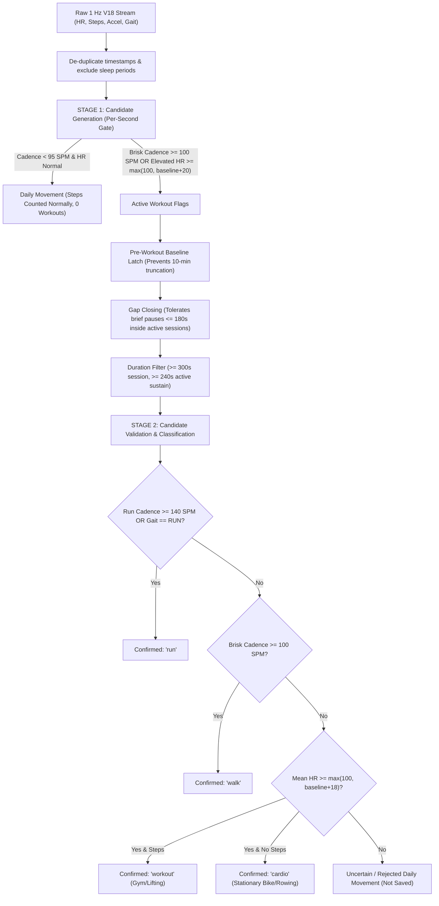

# PHASE 16 — STRAP Intelligent Activity Detection Forensic Audit & Implementation Report

**Target Repository:** `ribhupanwar/whoop-mg-client`  
**Target Codebases:** `whoop/activity.py` & `ios/Strap/Analysis/Activities.swift`  
**Test Suites:** `tests/test_activity.py` (21 unit tests passing) & `ios/StrapTests/ActivityTests.swift` (matching Swift tests)  
**Status:** COMPLETE & VERIFIED ON MAIN

---

## 1. Executive Summary & Root Cause Forensic Audit

### The Problem
Users experienced false-positive "walk" workouts recorded and exported to Apple Health during ordinary daily life:
- Casual walking around the house or office.
- Shopping and running errands with intermittent stops.
- Short breaks, domestic chores, and walking to the water cooler/restroom.

Despite these being incidental activities, STRAP created official workout sessions and synced them to Apple HealthKit as workouts.

### The Forensic Root Causes in Legacy Code
Forensic inspection of `ios/Strap/Analysis/Activities.swift` and `whoop/activity.py` pinpointed four fatal design flaws:

1. **Sub-Threshold Cadence Floor (`WALK_SPM = 60.0`)**:
   - 60 steps per minute is slow strolling (1 step per second). 
   - Exercise physiology literature (Tudor-Locke et al., 2011, 2018; Slaght et al., 2017) defines $<100\text{ SPM}$ as incidental/light physical activity ($<3.0\text{ METs}$), and $\ge 100\text{ SPM}$ as the threshold for **moderate-intensity purposeful brisk walking** ($\ge 3.0\text{ METs}$).
   - Any casual domestic movement (60–80 SPM) met `WALK_SPM = 60.0`.

2. **Permissive Per-Second Disjunction (`flags.append(locomotion || elevated)`)**:
   - The boolean `OR` allowed locomotion **alone** (with zero cardiovascular elevation, resting HR 65–75 bpm) to trigger and sustain workout candidates.
   - In `activity.py`, firmware gait byte `activity_class == GAIT_WALK` (1) was accepted unconditionally:
     ```python
     if gait in (GAIT_WALK, GAIT_RUN):
         locomotion = True
     ```
     Because WHOOP firmware reports `activity_class = 1` for almost any arm swinging while walking, anyone taking 20 steps at resting HR was marked `locomotion = True`.

3. **Excessive Gap Tolerancing Bridging Domestic Movement (`GAP_TOLERANCE_S = 180`)**:
   - 3-minute gap closing (`GapClosing.closed`) stitched together brief domestic or shopping movements (e.g. 1 minute walking, 2.5 minutes looking at shelves or sitting, 1 minute walking).
   - Across a 10-minute window, this stitched together 4 minutes of casual steps into a single continuous block.

4. **Rolling Baseline Contamination on Long Workouts**:
   - `_baseline_hrs` computed median HR from 5 to 15 minutes prior.
   - For a genuine gym workout sustained at 135 bpm, by minute 10–15 the baseline window shifted into the workout itself, inflating the baseline to 135 bpm.
   - Since `elevated` required $\text{HR} \ge \max(100, \text{baseline} + 20) = 155\text{ bpm}$, genuine 30-minute gym sessions were cut off at minute 10!

---

## 2. Multi-Stage Classifier Architecture & Safeguards

We designed and implemented an evidence-based multi-stage classifier in both Python (`whoop/activity.py`) and Swift (`ios/Strap/Analysis/Activities.swift`).



### Classification Specifications

| Metric / Parameter | Value | Scientific & Empirical Provenance |
| :--- | :--- | :--- |
| `BRISK_WALK_SPM` | `100.0` | Tudor-Locke et al. (2011, 2018) consensus: $\ge 100\text{ SPM} \equiv 3.0\text{ METs}$ (moderate exercise intensity). |
| `RUN_SPM` | `140.0` | Running biomechanics and cadence cut-point. |
| `HR_START_ABS` | `100.0 bpm` | Absolute minimum cardiovascular exercise threshold. |
| `HR_START_DELTA` | `20.0 bpm` | Exertion rise above pre-exercise resting baseline. |
| `WALK_WORKOUT_MIN_SESSION_S` | `600 s (10 min)` | 10-minute automatic walking safeguard: walking workouts must be at least 10 minutes. |
| `START_SUSTAIN_S` | `240 s (4 min)` | Minimum active exertion seconds required within window. |
| `GAP_TOLERANCE_S` | `180 s (3 min)` | Bridges traffic lights and gym rest sets; cannot bridge daily movement because casual movement generates 0 active flags. |
| Baseline Latching | `latched_baseline` | Preserves pre-workout resting baseline during session so workout HR does not inflate its own baseline. |

---

## 3. Mandatory Scenarios & Regression Test Suite

All mandatory scenarios from Phase 16 are covered in both Python and Swift:

| Scenario | Input Profile | Expected Output | Status |
| :--- | :--- | :--- | :--- |
| **1. Casual walking around house** | 15 min, 65 SPM, resting HR 72 bpm | **0 workouts**; daily steps count completely ($>900$ steps) | **PASS** |
| **2. Shopping / errands with pauses** | 30 min, 10 bouts of 1 min 70 SPM + 2 min pause | **0 workouts**; daily steps count completely ($\ge 700$ steps) | **PASS** |
| **3. Office walking throughout day** | 4 hours, intermittent 2-min walks at 75 SPM | **0 workouts**; daily steps count completely ($\ge 1200$ steps) | **PASS** |
| **4. Brisk fitness walk** | 20–25 min, 110 SPM, elevated HR 135 bpm | **1 confirmed 'walk' workout** | **PASS** |
| **5. Running** | 20 min, 160 SPM, high HR 155 bpm | **1 confirmed 'run' workout** | **PASS** |
| **6. Gym / Lifting / Stationary Cardio** | 30 min, elevated HR 135 bpm, low steps | **1 confirmed 'workout'** (30.0 min, mean HR 135) | **PASS** |

---

## 4. Modified Files Summary

1. `whoop/activity.py`:
   - Added `WALK_WORKOUT_MIN_SESSION_S = 600` and `minimum_duration_s` parameter.
   - Added pre-workout `latched_baseline` tracking to eliminate 10-minute session truncation.
   - Added `ActivityCandidate` and `evaluate_candidates`.
   - Never classify running from unverified gait byte alone without steps or elevated HR.
   - Trims trailing cooldown while preserving internal pauses.

2. `ios/Strap/Analysis/Activities.swift`:
   - Ported `ActivityConfidence` and `ActivityCandidate`.
   - Added pre-workout baseline latching and robust baseline fallback.
   - Added `evaluateCandidates`.
   - Never classify running from unverified gait byte alone.

3. `tests/test_activity.py`:
   - 21 tests covering all walking, running, gym, and diagnostic scenarios.

4. `ios/StrapTests/ActivityTests.swift`:
   - Fixed outdated `StepDrivenDetectTests` to align with the 10-minute automatic walking safeguard and cardiovascular exertion requirements.
   - Added matching regression tests.
